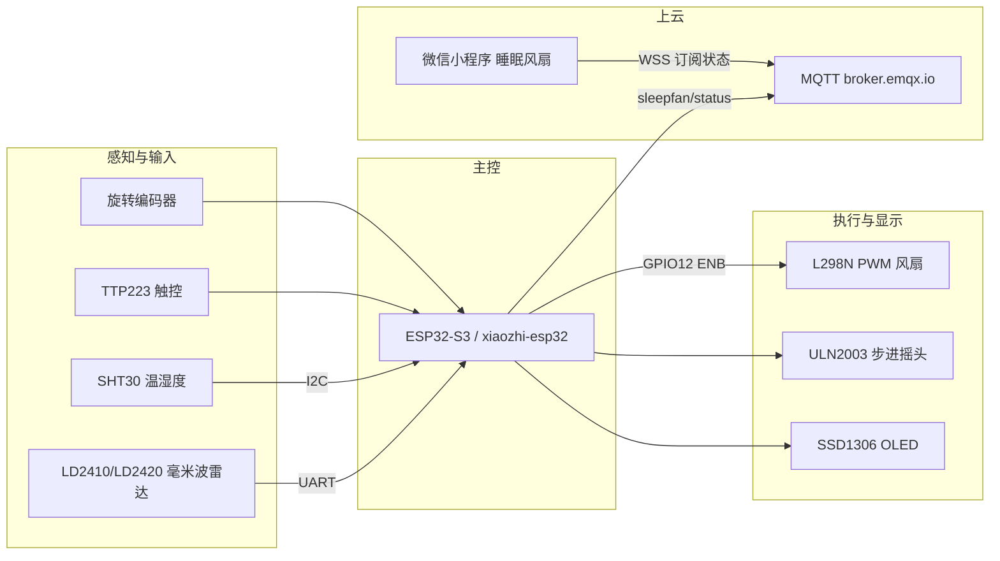

# 基于毫米波雷达与多传感器融合的智能睡眠风扇控制系统

Intelligent Sleep Fan Control System with mmWave Radar and Multi-Sensor Fusion

本科毕业设计。系统在本地完成床区占位检测、温湿度采集和风扇控制，也可通过微信小程序查看与调节运行状态。

| 项目 | 说明 |
| --- | --- |
| 作者 | 曾杰（物联网工程） |
| 指导教师 | 谢品章 |
| 角色 | 项目负责人 |
| 周期 | 2026-09 至 2026-11 |
| 主控 | ESP32-S3 |
| 固件基础 | 开源项目 xiaozhi-esp32 二次开发，board 为 `bread-compact-wifi` |

> 照片待补：请将整机外观、接线细节、OLED 界面和小程序截图放入 `docs/photos/`，再在下方引用，例如 `docs/photos/overview.jpg`。

## 项目简介

这是一套面向睡眠场景的智能风扇控制系统。主控采用 ESP32-S3。LD2410/LD2420 毫米波雷达负责床区占位检测，不用于统计人数；SHT30 采集温湿度。系统提供舒适、自然风、睡觉、智能四种本地工作模式，由 L298N 以 PWM 驱动风扇，并由 ULN2003 带动步进电机摇头。

本地面板用 TTP223 触控键循环选择调节项，用旋转编码器改变当前项，SSD1306 OLED 显示状态。设备通过 MQTT 向 `broker.emqx.io` 上报状态，主题为 `sleepfan/status`。微信小程序「睡眠风扇」提供监控、控制、趋势、设置四个页面，并通过 WSS 订阅设备状态。

## 主要特性

- 床区占位检测：毫米波雷达判断床区是否有人，不能计人数
- 温湿度采集：SHT30，I2C 地址 `0x44`，与 OLED 共用 I2C 总线
- 四种本地模式：舒适、自然风、睡觉、智能
- 风扇调速：L298N PWM 驱动，风速 1-5 档，可降到 0 停转
- 步进摇头：ULN2003 驱动；软回零时撞机械限位，未使用霍尔传感器
- 本地交互：触控循环选择「模式 / 定时 / 风速」，旋钮调节当前项
- 定时：每格 \pm10 分钟，`0` 为关闭，上限 480 分钟
- 远程查看与控制：MQTT 状态上报，微信小程序四页（监控 / 控制 / 趋势 / 设置）
- 语音按键：沿用 xiaozhi-esp32 的 BOOT 长按方式

## 系统架构

感知、决策和执行都在 ESP32-S3 完成本地闭环。雷达、温湿度和面板输入进入主控；主控输出风扇 PWM、步进摇头和 OLED 显示，同时把运行状态发到 MQTT。小程序通过 WSS 订阅该状态，用于监控和控制。



## 硬件与引脚

板级配置为 xiaozhi-esp32 的 `bread-compact-wifi`。下表与 `firmware/config.h`、`firmware/compact_wifi_board.cc` 的引脚一致。每根线怎么接、以及仓库里没写明的电源和跳线，见 [接线说明](docs/wiring.md)。

| 功能 | 器件 | 连接 |
| --- | --- | --- |
| 风扇 PWM | L298N | `GPIO12` 接 `ENB`；电机接 `OUT3` / `OUT4`。方向脚不占 GPIO |
| 毫米波雷达 | LD2410 / LD2420 | UART1：ESP RX `GPIO45` 接雷达 TX，ESP TX `GPIO48` 接雷达 RX |
| 温湿度 | SHT30 | I2C 地址 `0x44`；SDA = `GPIO10`，SCL = `GPIO11` |
| 显示 | SSD1306 OLED | 与 SHT30 同一 I2C，地址 `0x3C`。`bread-compact-wifi` 构建为 128×32，另有 128×64 |
| 步进摇头 | 28BYJ-48 + ULN2003 | `IN1` / `IN2` / `IN3` / `IN4` = `GPIO1` / `GPIO2` / `GPIO21` / `GPIO47` |
| 触控 | TTP223 | `GPIO14`，高电平有效 |
| 旋转编码器 | KY-040 | A/CLK = `GPIO40`，B/DT = `GPIO39`，SW = `GPIO18` |
| 语音按键 | 板载 BOOT | `GPIO0`。长按为原有语音入口 |
| 空气质量 | MQ-135 | AO 经 10k/20k 分压后接 `GPIO9`（ADC1_CH8） |

补充说明：

- SHT30 与 OLED 共用 I2C0。固件把 `GPIO10` 配成 SDA、`GPIO11` 配成 SCL。
- L298N 的方向输入没有对应 GPIO（`FAN_AIN2_GPIO` 为 `GPIO_NUM_NC`）。`IN` 脚接高还是接地，`config.h` 与 `compact_wifi_board.cc` 的注释不一致，[接线说明](docs/wiring.md) 并列两处原文，不在这里选定一种。
- 步进摇头采用软回零：运转至机械限位后停止。固件没有霍尔传感器引脚。
- 毫米波雷达只做床区占位检测，不能计人数。
- MQ-135 只上报 ADC 原始值，不参与档位决策。10k 与 20k 在分压里的具体位置，仓库没有写。

## 软件与交互

### 本地工作模式

| 模式 | 行为 |
| --- | --- |
| 舒适 | 按当前档位恒定运转 |
| 自然风 | 在当前档附近做 PWM 起伏 |
| 睡觉 | 从偏低档起步，每 30 分钟降一档，直至微风 |
| 智能 | 根据毫米波雷达的占位、睡眠判定和 SHT30 温度决策。湿度会采集并上报，当前不参与档位 |

### 面板操作

- 触控键（TTP223，`GPIO14`，高电平有效）：循环选择当前调节项，顺序为模式、定时、风速。
- 旋转编码器（KY-040，A/CLK = `GPIO40`，B/DT = `GPIO39`）：调节当前选中项。方向反了就对调这两根线。
- 编码器按键（SW = `GPIO18`）：单击同样循环切换调节项。固件没有给这颗键注册长按。
- 定时：每格增加或减少 10 分钟；设为 `0` 表示关闭定时；上限为 480 分钟。
- 风速：可调范围为 1-5 档，也可以降到 0，使风扇停转。
- BOOT（`GPIO0`）：长按切换对话，与 xiaozhi-esp32 原有方式一致。启动阶段短按进入配网；之后短按开/关摇头。

OLED 用于本地显示当前模式、定时和风速等信息。

## 小程序与 MQTT

设备侧通过 MQTT 上报运行状态：

- Broker：`broker.emqx.io`（公共 MQTT 服务）
- 主题：`sleepfan/status`

微信小程序名称为「睡眠风扇」，包含四个页面：

- 监控
- 控制
- 趋势
- 设置

小程序通过 WSS 订阅设备状态，用于页面展示和后续控制。本 README 不展开尚未固定成文的报文字段或 WSS 地址，以免和实现细节不一致。

## 目录说明

```text
.
├── firmware/      # ESP32-S3 固件，基于 xiaozhi-esp32（board: bread-compact-wifi）二次开发
├── miniprogram/   # 微信小程序「睡眠风扇」
├── docs/
│   ├── wiring.md  # 接线说明
│   └── photos/    # 照片目录，目前还没有照片
└── README.md
```

接线见 [docs/wiring.md](docs/wiring.md)。编译、烧录和小程序导入步骤，以 `firmware/`、`miniprogram/` 与 `docs/` 中的现有说明为准。

## 当前范围

下列内容不属于本仓库已经交付的能力，避免审阅时产生误解：

- 空气质量判断尚未交付。固件会把 MQ-135 的 AO（`GPIO9`，须先经 10k/20k 分压）采成原始 ADC 并写入 `mq135_raw`，这个值不参与档位决策，也没有换算成空气质量。分压的具体接法见 [接线说明](docs/wiring.md)。
- 通过语音调节风速尚未完成实测验证，不作为已实现功能。本项目目前仅保留 BOOT 长按这一原有语音入口。
- 毫米波雷达只用于床区占位检测，不能统计人数。

## 开源说明

本项目固件基于开源项目 xiaozhi-esp32 二次开发，板级配置为 `bread-compact-wifi`。二次开发主要覆盖睡眠风扇相关的传感采集、风扇与摇头驱动、四种本地模式、面板交互，以及 MQTT 状态上报。原项目的语音交互仍通过 BOOT 长按使用。
