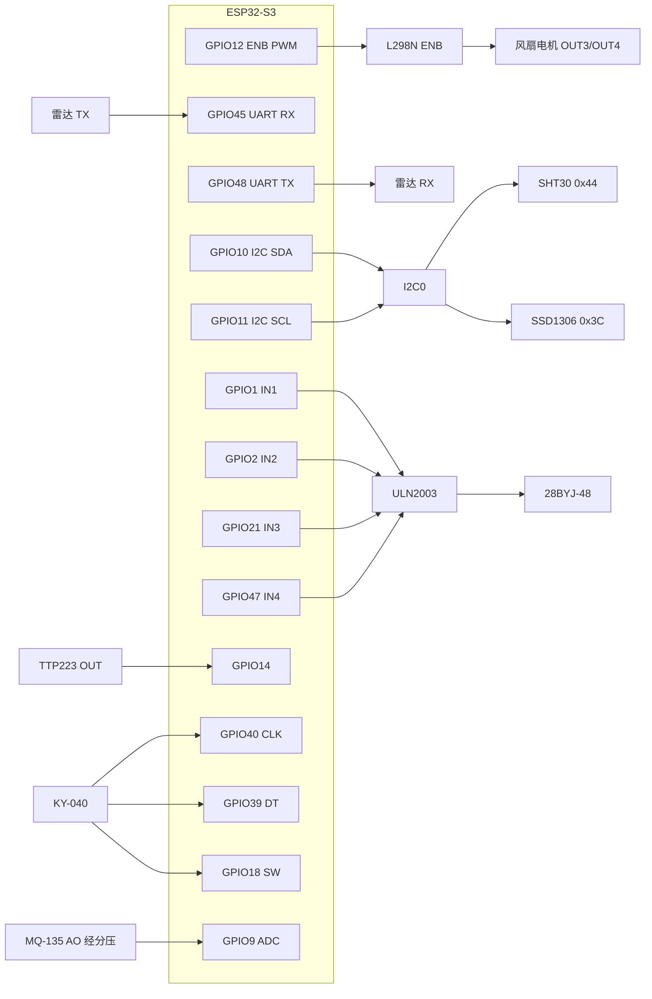

# 接线说明

本文按 `firmware/config.h` 和 `firmware/compact_wifi_board.cc` 里已经写明的引脚整理，供没看过仓库的人对照接线。主控是 ESP32-S3，板级为 xiaozhi-esp32 的 `bread-compact-wifi`。引脚号都是这颗芯片的 GPIO 编号。

`docs/photos/` 里目前只有 `.gitkeep`，整机和接线照片都还没有放进来。下文的表和示意图依据固件整理，不附实物照片。

只收固件真正配置了的信号。某一处注释写了、另一处注释写得不一样的，下文并列原文，不合成一种接法。仓库没写的供电电压、跳线和电阻接法，集中放在文末，请以实物或原理图为准。

## 配件

| 名称 | 用途 | 依据 |
| --- | --- | --- |
| ESP32-S3 开发板 | 主控。板级名 `bread-compact-wifi` | `firmware/config.json` 的 `target` 为 `esp32s3` |
| L298N | 直流风扇的 PWM 驱动。类注释开头仍写 DRV8833，宏名也沿用 AIN1/AIN2；同文件写明当前实际使用的是 L298N | `FanMotor` 的接线注释，`FAN_AIN1_GPIO` |
| 直流风扇电机 | 接到 L298N 的 `OUT3` / `OUT4`。电机型号仓库没写 | `FanMotor` 的接线注释 |
| LD2410 / LD2420 | 毫米波雷达，只做床区占位，不能计人数。走 UART1 | `RADAR_UART_RX_GPIO` / `RADAR_UART_TX_GPIO`，`InitRadar` |
| SHT30 | 温湿度。与 OLED 共用一条 I2C，器件地址 `0x44` | `InitSht30` |
| SSD1306 OLED | 本地显示模式、定时和风速。与 SHT30 共用 I2C，器件地址 `0x3C` | `InitializeDisplayI2c`、`InitializeSsd1306Display` |
| 28BYJ-48 | 五线步进电机，带动风扇摇头 | `config.h` 步进注释 |
| ULN2003 | 步进电机驱动，四个输入由 GPIO 直接推 | `STEPPER_IN1_GPIO` 至 `STEPPER_IN4_GPIO` |
| TTP223 | 电容触控。单击循环切换「模式 / 定时 / 风速」 | `TOUCH_BUTTON_GPIO`，`InitializeButtons` |
| KY-040 | 旋转编码器。A/B 调节当前项，SW 为按键 | `ENCODER_A_GPIO` / `ENCODER_B_GPIO` / `ENCODER_SW_GPIO` |
| 板载 BOOT | 开发板自带按键，接 `GPIO0`。本仓库没有再定义一颗外接语音键 | `BOOT_BUTTON_GPIO` |
| MQ-135 | 空气质量传感器。固件采样 AO 的原始 ADC 值并上报；档位决策不使用这个数 | `MQ135_ADC_CHANNEL`，`DecisionEngine::Evaluate` |

麦克风和喇叭的型号不在本仓库里。`config.h` 声明了一组 I2S 引脚，并传给 `NoAudioCodecSimplex`；这个编解码实现文件不在本仓库，所以下文只把脚位列入占用表，不写接插件。

## 信号接线总表

本表只列固件会配置的信号线。L298N 的方向脚、各模块供电、MQ-135 分压的具体接法不在本表中，见后面各节。

| 模块信号 | ESP32-S3 | 方向 | 固件里的做法 |
| --- | --- | --- | --- |
| L298N `ENB` | `GPIO12` | 输出 | LEDC PWM，20 kHz，10 位。宏名 `FAN_AIN1_GPIO` |
| 雷达 TX | `GPIO45` | 输入 | UART1 的 RX。宏名 `RADAR_UART_RX_GPIO` |
| 雷达 RX | `GPIO48` | 输出 | UART1 的 TX。宏名 `RADAR_UART_TX_GPIO` |
| I2C SDA（SHT30 与 OLED） | `GPIO10` | 总线 | `DISPLAY_SDA_PIN`，内部上拉打开 |
| I2C SCL（SHT30 与 OLED） | `GPIO11` | 总线 | `DISPLAY_SCL_PIN`，内部上拉打开 |
| ULN2003 `IN1` | `GPIO1` | 输出 | `STEPPER_IN1_GPIO` |
| ULN2003 `IN2` | `GPIO2` | 输出 | `STEPPER_IN2_GPIO` |
| ULN2003 `IN3` | `GPIO21` | 输出 | `STEPPER_IN3_GPIO` |
| ULN2003 `IN4` | `GPIO47` | 输出 | `STEPPER_IN4_GPIO` |
| TTP223 `OUT` | `GPIO14` | 输入 | 高电平有效 |
| KY-040 `CLK`（代码里的 A） | `GPIO40` | 输入 | 内部上拉，轮询 |
| KY-040 `DT`（代码里的 B） | `GPIO39` | 输入 | 内部上拉，轮询 |
| KY-040 `SW` | `GPIO18` | 输入 | 按键。注释写低有效 |
| 板载 BOOT | `GPIO0` | 输入 | `BOOT_BUTTON_GPIO` |
| MQ-135 `AO`（经分压） | `GPIO9` | ADC 输入 | ADC1 通道 8。必须先分压再接到这只脚 |

BOOT 是板载按键，没有画成外接模块。图中也不画供电，因为仓库没有给出各模块的电源电压。

## 风扇：L298N

能按代码接上的只有这些：

| 从 | 到 |
| --- | --- |
| ESP32-S3 `GPIO12` | L298N 的 `ENB` |
| 风扇电机的两根线 | L298N 的 `OUT3`、`OUT4` |

`GPIO12` 上的信号是 PWM：LEDC 低速模式，定时器 0，通道 0，10 位分辨率，频率 20 kHz，上电占空比为 0。宏名叫 `FAN_AIN1_GPIO`，注释写的是 L298N 的 `ENB`。

`FAN_AIN2_GPIO` 定义为 `GPIO_NUM_NC`。`FanMotor` 只有在第二只脚不是 `GPIO_NUM_NC` 时，才会把它配成输出并拉低。按现在的宏，上电不会有第二只 GPIO 去驱动 L298N 的方向输入。

方向脚怎么接高、怎么接地，仓库里有两段注释，不能当成同一种接法：

- `compact_wifi_board.cc` 里「当前实际使用 L298N」写的是：`ENB=GPIO12(PWM), IN3=3.3V, IN4=GND, OUT3/OUT4=电机两线`。
- `config.h` 里 `FAN_AIN2_GPIO` 的注释，以及 `FanMotor` 构造函数里的注释，写的是：L298N 的 `IN2` 直接接 GND。

因此 `IN1`–`IN4` 哪一只接高、哪一只接地，本文不选定。电机电源、L298N 逻辑电源用多少伏，仓库也没有写。这两处请以实物或原理图为准。上面引用里出现的 3.3V 只属于第一段注释，不能单独当成供电说明。

## 毫米波雷达

雷达的 TX 接到 ESP 的 RX，雷达的 RX 接到 ESP 的 TX：

| 雷达模块 | ESP32-S3 |
| --- | --- |
| TX | `GPIO45`（ESP 的 UART RX） |
| RX | `GPIO48`（ESP 的 UART TX） |

`InitRadar` 使用 UART1，256000 波特率，8 数据位，无校验，1 停止位，无硬件流控。RTS、CTS 传的是 `UART_PIN_NO_CHANGE`，固件没有接这两只脚。

`config.h` 的注释写着「雷达 TX → ESP RX」「雷达 RX ← ESP TX」。日志格式是 `radar uart ready: RX=GPIO45 TX=GPIO48 @256000`。

雷达用来判断床区有没有人，以及距离。固件注释把协议称为 LD2420 族，器件名在 README 和代码里写成 LD2410 / LD2420 兼容。模块供电、是否与 ESP32-S3 共地、模块上除 TX/RX 以外的脚，仓库没有写。

## I2C：SHT30 与 SSD1306

两颗器件共用 `InitializeDisplayI2c` 建立的 I2C0。`display_i2c_bus_` 随后传给 `SensorHub`，SHT30 加在同一条总线上。

| 信号 | ESP32-S3 | 固件字段 |
| --- | --- | --- |
| SDA | `GPIO10` | `sda_io_num = DISPLAY_SDA_PIN` |
| SCL | `GPIO11` | `scl_io_num = DISPLAY_SCL_PIN` |

总线打开了内部上拉（`enable_internal_pullup = 1`）。外部上拉电阻的阻值，仓库没有写。

| 器件 | 7 位地址 | 固件里的时钟 |
| --- | --- | --- |
| SHT30 | `0x44` | 100 kHz |
| SSD1306 | `0x3C` | 400 kHz |

OLED 的复位脚在固件里是 `GPIO_NUM_NC`，没有指定模块上的 RESET 接到哪只 GPIO。SHT30 的 ADDR 脚、OLED 的地址选择脚怎么焊，仓库没有写；上面两个地址是固件实际访问的地址。

分辨率由编译选项决定，接线不变：

| `firmware/config.json` 里的构建 | Kconfig |
| --- | --- |
| `bread-compact-wifi`（文件里的第一项） | `CONFIG_OLED_SSD1306_128X32=y` |
| `bread-compact-wifi-128x64` | `CONFIG_OLED_SSD1306_128X64=y` |

`config.h` 里还有 `CONFIG_OLED_SH1106_128X64` 分支。`config.json` 的两个构建都没有打开它。选中时高度为 64，I2C 地址仍是初始化函数里的 `0x3C`。

## 步进摇头：28BYJ-48 与 ULN2003

主控侧四根信号线：

| ULN2003 | ESP32-S3 |
| --- | --- |
| `IN1` | `GPIO1` |
| `IN2` | `GPIO2` |
| `IN3` | `GPIO21` |
| `IN4` | `GPIO47` |

四只脚都配成推挽输出，内部上拉和内部下拉都关闭。停转时四路都输出低电平。注释说这四只脚在面包板的同一侧；`GPIO38` 避开，因为板载 RGB 常用这一脚。本仓库没有把板载 RGB 定义成要外接的灯。

`config.h` 对电机线的原文是：28BYJ-48 五线步进，红线是公共端，接到 ULN2003 的 `+VCC`；橙、黄、粉、蓝是 A、B、C、D 四相。注释没有把这四相逐根对应到 `IN1`–`IN4`，也没有写 `+VCC` 是多少伏。四相接到驱动板哪一个输出，请以实物或原理图为准。

摇头是软回零。固件里没有霍尔传感器引脚。第一次启动摇头时，先按 `STEPPER_HOME_DELAY_US` 慢速走 `STEPPER_HOME_STEPS`（920）步，靠撞机械限位把位置定住，再退回半幅。之后用步数计数回中心。断电后 `homed_` 清掉，下次启动再撞一次限位。

## 触控与旋转编码器

TTP223 的 `OUT` 接 `GPIO14`。构造按键时第二个参数为 `true`，固件按高电平有效处理。单击回调是 `CycleFocus`，在模式、定时、风速之间循环。`config.h` 里还有一句「按住说话」。`InitializeButtons` 没有把这只脚注册成语音键；语音长按在 BOOT。模块的供电电压，仓库没有写。

KY-040 的三根信号：

| 模块脚 | ESP32-S3 | 代码中的名字 |
| --- | --- | --- |
| `CLK` | `GPIO40` | `ENCODER_A_GPIO` |
| `DT` | `GPIO39` | `ENCODER_B_GPIO` |
| `SW` | `GPIO18` | `ENCODER_SW_GPIO` |

`CLK` 和 `DT` 在 `RotaryEncoder` 里配成输入，内部上拉打开，任务里轮询，不使用 GPIO 中断。注释写明：转动方向反了，对调 `CLK` 和 `DT` 即可。

`SW` 的注释写：低有效，按下接到 GND，内部上拉。`Button` 的实现不在本仓库，这只脚的上拉是否由按键库打开，这里核对不到。`RotaryEncoder` 本身不配置 `GPIO18`。

这颗按键在 `InitializeButtons` 里只注册了单击，回调同样是 `CycleFocus`。没有 `OnLongPress`。`config.h` 写的「短按切模式 / 长按切定时」，以及 `FanModeController` 类注释里的同一说法，和这个回调不一致。接线以引脚为准：`SW` 到 `GPIO18`。

上电时焦点是风速（`focus_` 初值为 `Focus::Speed`）。此后每单击一次 TTP223 或编码器 SW，焦点按「模式 → 定时 → 风速」移一格，旋钮调节当前这一格。

## 板载 BOOT

`BOOT_BUTTON_GPIO` 是 `GPIO0`，使用开发板自带的 BOOT，不另接按键。

| 操作 | `InitializeButtons` 里的行为 |
| --- | --- |
| 长按 | `ToggleChatState`，沿用 xiaozhi-esp32 的对话切换 |
| 短按，且设备还在启动 | `EnterWifiConfigMode` |
| 短按，且已经过了启动阶段 | 开/关步进摇头 |

## MQ-135

`config.h` 写明：AO 经 10k/20k 分压后接 `GPIO9`（ADC1 通道 8）。`SensorHub` 的注释写：必须先分压再接，否则会损坏 GPIO。固件使用 ADC1、通道 8、衰减 `ADC_ATTEN_DB_12`。决策任务每次循环采样一次，循环末尾延时 2000 ms，原始值进入 MQTT 字段 `mq135_raw`。

`DecisionEngine::Evaluate` 不读取这个原始值，也没有把它换算成空气质量。

10k 和 20k 在分压电路里各接哪一端，仓库没有画。传感器的加热电压和 VCC，仓库也没有写。这两处请以实物或原理图为准。

## 固件已声明、本仓库没有外围接法的引脚

`AUDIO_I2S_METHOD_SIMPLEX` 处于打开状态，实际传给音频对象的是下面这组脚。双工那一组宏在 `#else` 里，当前编译用不到。

| 宏 | GPIO | 注释中的角色 |
| --- | --- | --- |
| `AUDIO_I2S_MIC_GPIO_WS` | `GPIO4` | 麦克风 WS |
| `AUDIO_I2S_MIC_GPIO_SCK` | `GPIO5` | 麦克风 SCK |
| `AUDIO_I2S_MIC_GPIO_DIN` | `GPIO6` | 麦克风 DIN |
| `AUDIO_I2S_SPK_GPIO_DOUT` | `GPIO7` | 喇叭 DOUT |
| `AUDIO_I2S_SPK_GPIO_BCLK` | `GPIO15` | 喇叭 BCLK |
| `AUDIO_I2S_SPK_GPIO_LRCK` | `GPIO16` | 喇叭 LRCK |

`no_audio_codec` 的实现不在本仓库，因此这里不能补充麦克风、功放的型号和供电。接线时先把这些 GPIO 视为固件已经声明占用。

另外三处明确空着：

| 宏 | 值 | 注释 |
| --- | --- | --- |
| `BUILTIN_LED_GPIO` | `GPIO_NUM_NC` | 原来的 `GPIO48` 已让给雷达 TX |
| `VOLUME_UP_BUTTON_GPIO` | `GPIO_NUM_NC` | `GPIO40` 已用作编码器 CLK |
| `VOLUME_DOWN_BUTTON_GPIO` | `GPIO_NUM_NC` | `GPIO39` 已用作编码器 DT |

## 仓库没有写明的连接

下面这些在 `firmware/` 和现有文档里都没有确定写法。请以实物或原理图为准，不要按常见模块自行补全：

- 各模块的供电电压。包括风扇电机、L298N 的电机电源和逻辑电源、ULN2003 的 `+VCC`、雷达、SHT30、OLED、TTP223、KY-040、MQ-135 的加热端和 VCC。
- L298N `IN1`–`IN4` 哪些接高、哪些接地。两处注释见上文，固件不驱动这些脚。
- MQ-135 分压网络里 10k 与 20k 的具体位置。
- SHT30 的 ADDR 脚、SSD1306 的地址选择脚、OLED 模块上 RESET 针脚的去向。
- I2C 外部上拉的阻值。固件只写了打开内部上拉。
- 各模块的电源地是否与 ESP32-S3 共地。注释里出现过的 GND，只针对某一段有冲突的 L298N 方向脚说明，或针对编码器 `SW` 按下接 GND，没有一张总的共地图。
- 28BYJ-48 橙、黄、粉、蓝四相各自进 ULN2003 的哪一相输出。红线接驱动板 `+VCC` 是注释写了的，电压没有写。
- 雷达模块上除 TX、RX 以外的脚。
- 麦克风、喇叭的型号、接插件和供电。
